# Bite

**Snap your meal. Know your calories.**

Bite is a Flutter app that recognises the food in a photo and estimates its calories, protein, carbs and fat. Meals are saved to your account, so you can track what you eat each day against a personal daily calorie reference.

Final-year project: *The Design and Implementation of an AI-Based Food Recognition Application for Automated Calorie Estimation*. Chidiebube Praise Iroezindu, Department of Computer Science, University of Port Harcourt.

> Every calorie figure in the app is an estimate. Bite is not a medical or dietary tool.

<p align="center">
  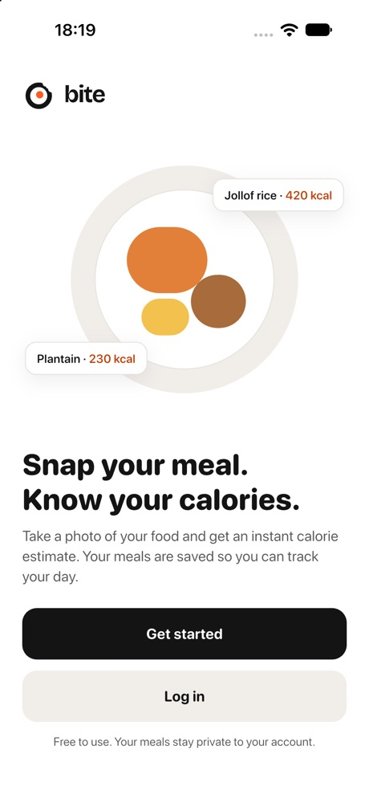
  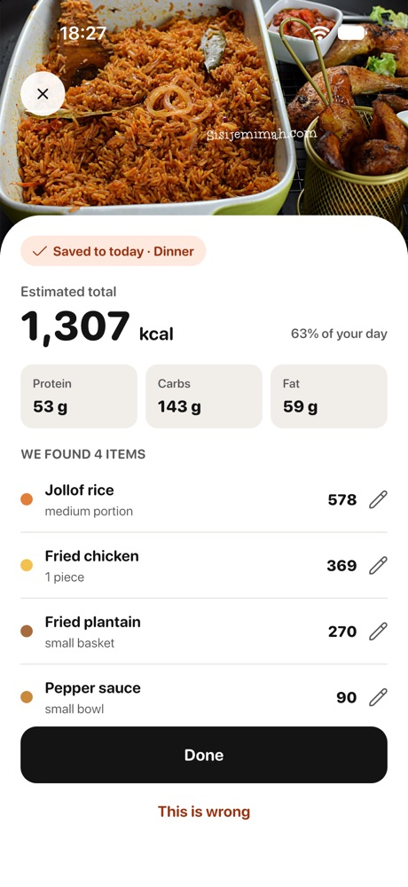
  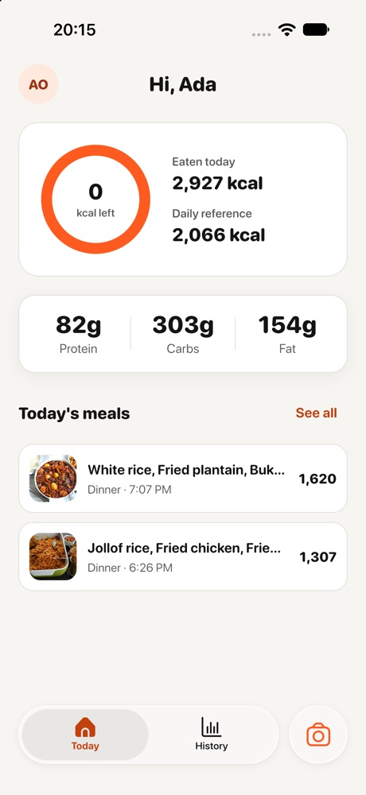
</p>

## Features

- **Photo to calories.** Take a photo, or pick one from the gallery. Bite finds each food on the plate and estimates its portion, calories and macros.
- **Optional details for a closer estimate.** Before analysing, you can say what's on the plate, choose a portion size, and note anything the camera can't see (cooking oil, sauces).
- **Fix what the AI got wrong.** Edit any item's food or amount (grams, ml or servings) and the estimate updates from the nutrition database. You can also remove items or flag a whole result as wrong.
- **Daily tracking.** Home shows calories eaten today against your daily reference, plus protein, carbs and fat. History charts your intake by day, week or month.
- **Personal daily reference.** Calculated from your age, sex, height, weight, activity level and goal (lose, maintain or gain weight).
- **Accounts.** Sign up with email and password, or sign in with Google. Your photos and meals are private to your account.
- **Native feel on both platforms.** On iOS the app uses SF Pro Rounded and a floating liquid-glass tab bar. On Android it uses Poppins and a Material 3 navigation bar.

## Screenshots

All screenshots are from the iOS simulator.

### Getting started

<table>
  <tr>
    <td align="center"><br>Welcome</td>
    <td align="center">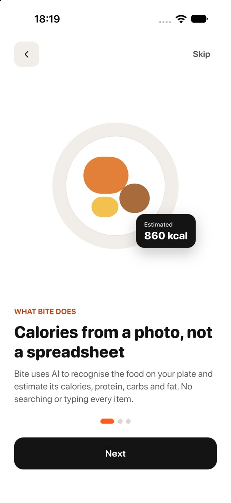<br>Onboarding</td>
    <td align="center">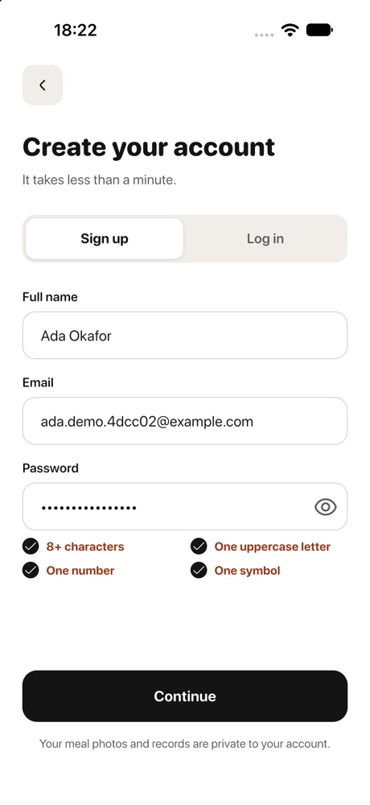<br>Create account</td>
    <td align="center">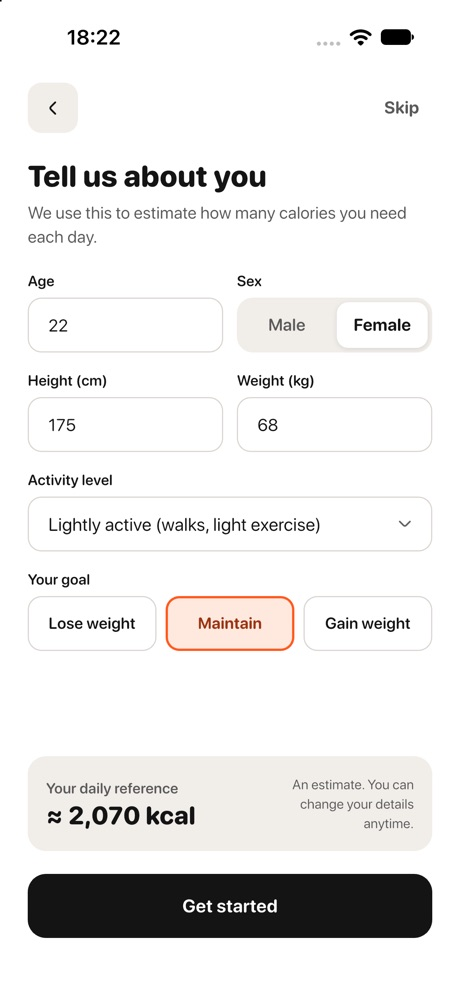<br>Profile setup</td>
  </tr>
</table>

### Scanning a meal

<table>
  <tr>
    <td align="center">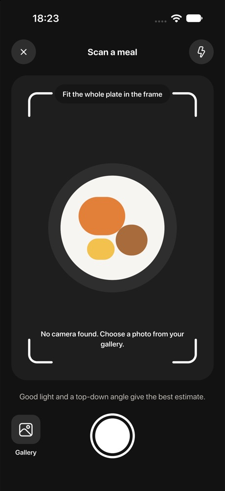<br>Capture</td>
    <td align="center">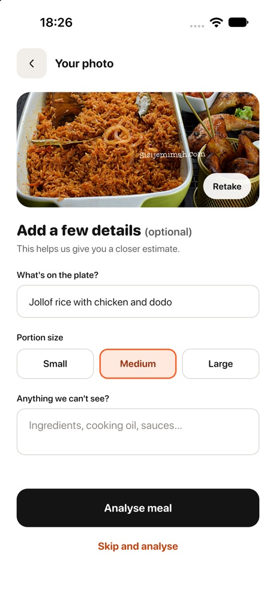<br>Meal details</td>
    <td align="center">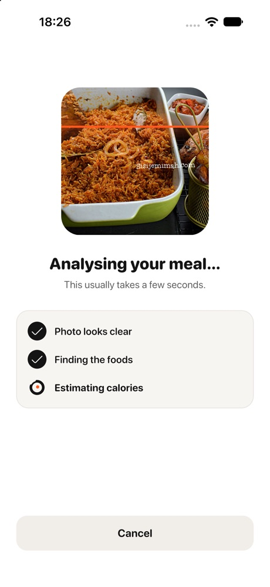<br>Analysing</td>
    <td align="center"><br>Result</td>
  </tr>
  <tr>
    <td align="center">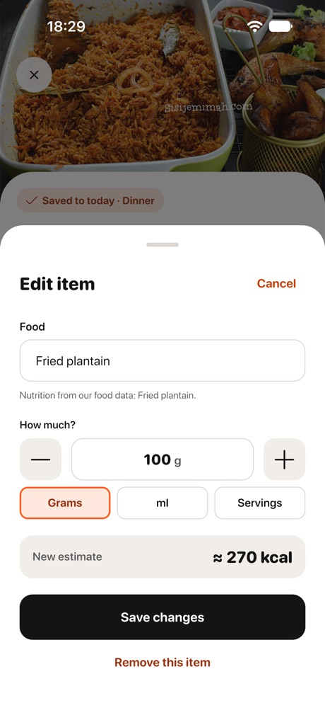<br>Edit item</td>
    <td align="center">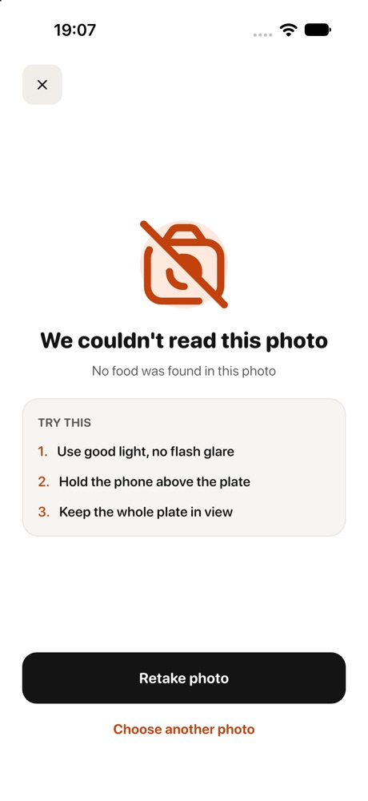<br>Couldn't analyse</td>
    <td></td>
    <td></td>
  </tr>
</table>

### Tracking

<table>
  <tr>
    <td align="center"><br>Home</td>
    <td align="center">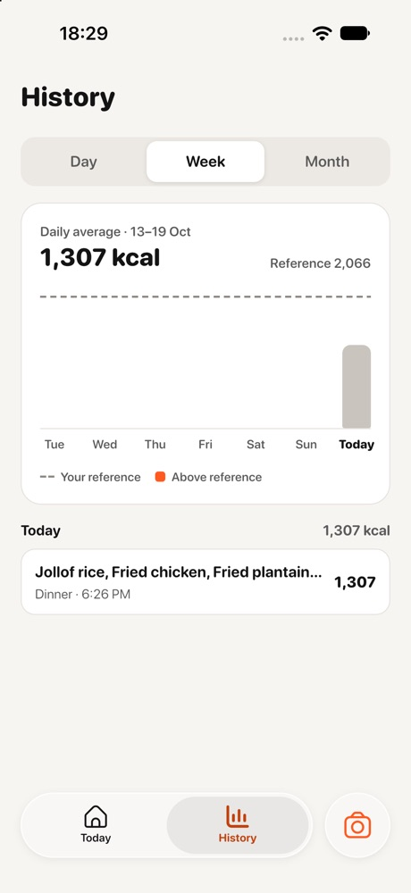<br>History</td>
    <td align="center">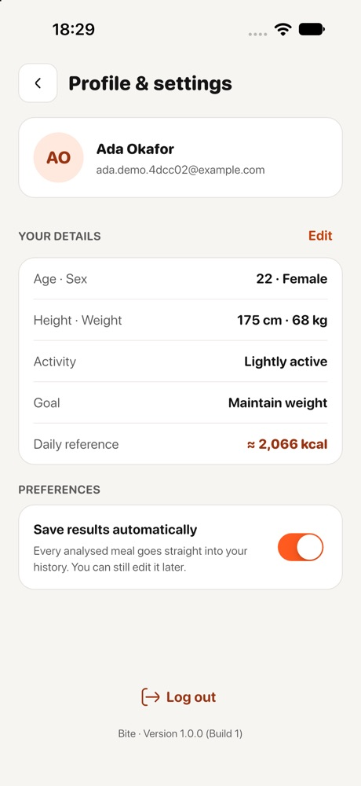<br>Profile &amp; settings</td>
    <td></td>
  </tr>
</table>

## How it works

1. The app uploads the meal photo, and any details you added, to the Bite backend.
2. The backend sends the photo to a vision AI model (Claude by default, Gemini as an alternative). The model names each food and estimates its portion.
3. The backend checks those foods against its nutrition reference data, works out calories and macros, and returns the result.
4. The meal is saved to your history, either automatically or when you tap Done (set this in Profile & settings).

The backend is a separate Express + TypeScript project with SQLite. Its README lists the endpoints.

## Tech stack

| Area | Choice |
| --- | --- |
| Framework | Flutter (Dart 3.13+) |
| State | Riverpod 3 with code generation |
| Architecture | Feature-first clean architecture, MVVM |
| Networking | Dio + Retrofit, models with freezed + json_serializable |
| Errors | fpdart `Either<Failure, T>` |
| Navigation | go_router |
| Local storage | flutter_secure_storage (tokens), shared_preferences (settings), sqflite (offline cache) |
| Auth | Email/password, plus Google Sign-In through Firebase Auth |
| Icons | UIcons by Flaticon |

## Project structure

```
lib/
  main.dart       # start-up: storage, Firebase, ProviderScope
  app/            # App widget, router, tab shell
  core/           # shared code: network, storage, theme, widgets
  features/
    onboarding/  auth/  profile/  home/  food_analysis/  history/  settings/
      data/          # API services, local sources, DTOs, repository implementations
      domain/        # entities, repository interfaces, use cases
      presentation/  # view models (Riverpod) and views
```

## Getting started

You need Flutter 3.47 or later and the Bite backend running locally (it listens on port 4000).

```sh
flutter pub get
dart run build_runner build
flutter run
```

The app expects the API at `http://localhost:4000/api/v1`, which works from the iOS simulator. The Android emulator reaches your machine at `10.0.2.2`:

```sh
flutter run --dart-define=API_BASE_URL=http://10.0.2.2:4000/api/v1
```

Other useful commands:

```sh
dart run build_runner watch   # regenerate code as you edit
flutter analyze
flutter test
```

Google sign-in uses the Firebase project `bite-466bf`. To use it on Android, register your signing key's SHA-1 in Firebase.

## Status

All screens are built, and every one is connected to the backend. Still to come:

- Offline cache for meals and summaries (only the profile is cached for now).
- Sign in with Apple. The data layer is ready, but it needs a paid Apple developer account.

## Credits

- Icons: [UIcons by Flaticon](https://www.flaticon.com/uicons).
- Fonts: SF Pro Rounded (Apple) on iOS, Poppins (Google Fonts) on Android, Bricolage Grotesque for the wordmark. SF Pro Rounded is licensed for mock-ups only, so it must be replaced before any App Store release.

For architecture rules and coding conventions, see [CLAUDE.md](CLAUDE.md).
